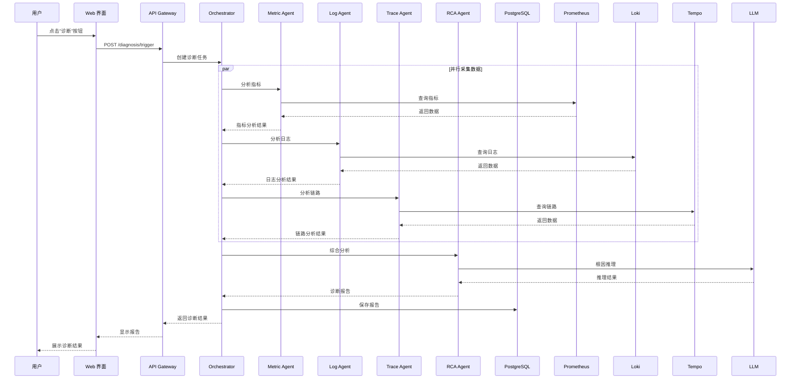
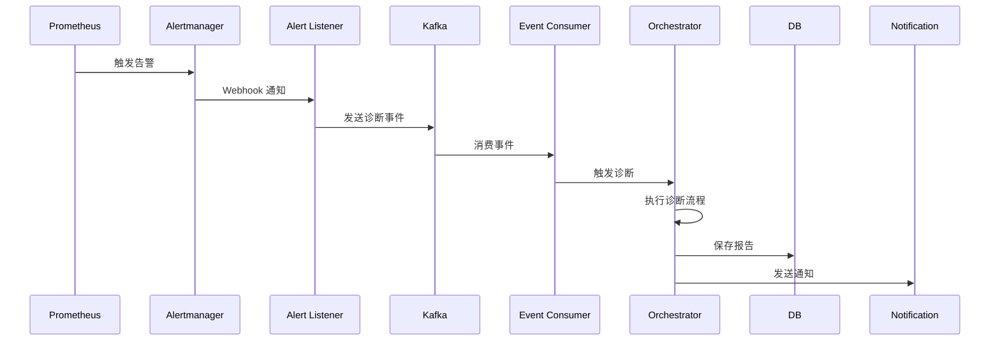

# AIOps 智能诊断平台 - 需求文档

## 文档信息

| 项目 | 信息 |
|------|------|
| **文档版本** | v2.0 |
| **创建日期** | 2026-11-11 |
| **最后更新** | 2026-11-11 |
| **文档状态** | Draft → Review → Approved |
| **负责人** | Product Team |
| **审核人** | Tech Lead, Architect |

---

## 目录

1. [项目概述](#1-项目概述)
2. [系统组成](#2-系统组成)
3. [功能需求](#3-功能需求)
4. [非功能需求](#4-非功能需求)
5. [技术架构](#5-技术架构)
6. [典型使用流程](#6-典型使用流程)
7. [阶段规划](#7-阶段规划)
8. [验收标准](#8-验收标准)
9. [企业级扩展需求](#9-企业级扩展需求)
10. [风险与依赖](#10-风险与依赖)
11. [成本预算](#11-成本预算)
12. [附录](#12-附录)

---

## 1. 项目概述

### 1.1 背景

随着微服务架构的普及和系统复杂度的提升，生产环境故障的定位和诊断成为运维团队面临的巨大挑战。传统的人工分析方式存在以下问题：

- **耗时长**：从告警到定位根因平均需要 30-60 分钟
- **依赖经验**：需要资深工程师才能快速定位问题
- **容易遗漏**：多源数据（指标、日志、链路）难以关联分析
- **无法复用**：诊断经验难以沉淀和传承

### 1.2 目标

构建一套 **AIOps 智能诊断系统**，通过 AI 技术实现：

1. **自动检测**：实时监控系统指标，自动发现异常
2. **智能诊断**：多 Agent 协作分析，快速定位根因
3. **知识沉淀**：构建故障知识库，持续学习优化
4. **效率提升**：将故障诊断时间从 30 分钟降低到 5 分钟以内

### 1.3 核心价值

| 价值维度 | 具体收益 |
|---------|---------|
| **效率提升** | 故障诊断时间减少 80% |
| **成本降低** | 减少 50% 的人工介入 |
| **知识沉淀** | 构建企业级故障知识库 |
| **能力提升** | 赋能初级工程师快速定位问题 |

### 1.4 系统定位

本系统由两部分组成：

1. **被测应用（Target App）**：一个故意植入常见生产问题的 Spring Boot 应用，作为 Agent 的检测目标和验证环境
2. **诊断 Agent（AIOps Agent）**：基于多 Agent 协作的智能诊断平台，负责监控、检测、分析并输出诊断报告

**价值闭环**：故障注入 → 自动检测 → 智能诊断 → 报告输出 → 知识沉淀

---

## 2. 系统组成

### 2.1 被测应用（Target App）

#### 2.1.1 功能定位

一个标准的 Spring Boot Web 应用，对外提供若干 HTTP 接口，每个接口故意植入一类典型生产问题，用于：

- **验证 Agent 能力**：测试 Agent 对各类问题的检测和诊断能力
- **模拟生产场景**：提供真实的故障数据和场景
- **可控的故障注入**：支持动态开启/关闭问题，便于分场景测试

#### 2.1.2 问题场景清单

| 接口路径 | 植入问题 | 问题描述 | 典型症状 |
|---------|---------|---------|---------|
| `/api/leak/memory` | 内存泄漏 | 静态集合不断累积对象，最终触发 OOM | JVM 内存持续上升，Full GC 频繁 |
| `/api/leak/thread` | 线程泄漏 | 创建线程但不释放，导致线程数耗尽 | 线程数持续增长，最终无法创建新线程 |
| `/api/slow/sql` | 慢 SQL | 模拟复杂查询，数据库响应极慢 | 接口响应时间 > 5s，数据库连接等待 |
| `/api/pool/exhaust` | 连接池耗尽 | 借出连接不归还，耗尽数据库连接池 | 连接池活跃连接数达到上限，请求阻塞 |
| `/api/cpu/spike` | CPU 飙高 | 死循环或密集计算，占用大量 CPU | CPU 使用率 > 90%，系统响应变慢 |
| `/api/deadlock` | 死锁 | 两个线程互相等待锁，导致请求挂起 | 部分请求永久阻塞，线程 dump 显示死锁 |
| `/api/normal` | 正常接口 | 无问题，用于对比基线 | 正常响应，指标稳定 |

#### 2.1.3 技术要求

| 技术项 | 要求 |
|-------|------|
| **框架** | Spring Boot 3.2.x + JDK 21 |
| **可观测性** | 集成 Micrometer + OpenTelemetry，暴露指标、日志、链路数据 |
| **问题控制** | 每个问题接口支持"触发开关"（配置或 API），可控制问题是否激活 |
| **健康检查** | 提供 `/actuator/health` 和 `/actuator/metrics` 端点 |
| **数据库** | H2（开发）/ MySQL（生产），用于模拟慢 SQL 和连接池场景 |

#### 2.1.4 可观测数据暴露

```yaml
# 指标暴露（Prometheus 格式）
- JVM 指标：内存使用、GC 次数、线程数
- HTTP 指标：QPS、P99 延迟、错误率
- 数据库指标：连接池活跃连接、等待队列长度
- 自定义指标：业务操作计数

# 日志输出
- 格式：JSON 结构化日志
- 级别：INFO（正常）/ WARN（异常）/ ERROR（错误堆栈）
- 输出：控制台 + 文件（按日期滚动）

# 链路追踪
- 协议：OpenTelemetry
- 上报：Tempo / Jaeger
- 采样率：100%（测试环境）
```

---

### 2.2 诊断 Agent（AIOps Agent）

#### 2.2.1 核心能力

| 能力 | 说明 |
|------|------|
| **自动感知** | 通过 Prometheus、Loki、Tempo 实时采集被测应用的可观测数据 |
| **异常检测** | 识别指标异常、日志异常、链路异常 |
| **多 Agent 协作** | Metric/Log/Trace/RCA Agent 分工协作，综合诊断 |
| **根因定位** | 输出根因排序、置信度、证据链 |
| **报告生成** | 结构化诊断报告，包含修复建议 |

#### 2.2.2 Agent 职责划分

```
┌─────────────────────────────────────────────────────────┐
│                   Orchestrator Agent                    │
│              (诊断流程编排与协调)                          │
└─────────────────────────────────────────────────────────┘
                           │
        ┌──────────────────┼──────────────────┐
        │                  │                  │
        ▼                  ▼                  ▼
┌──────────────┐   ┌──────────────┐   ┌──────────────┐
│ Metric Agent │   │  Log Agent   │   │ Trace Agent  │
│              │   │              │   │              │
│ 分析指标趋势  │   │ 分析日志模式  │   │ 分析调用链   │
│ 识别资源异常  │   │ 识别错误堆栈  │   │ 定位慢节点   │
└──────────────┘   └──────────────┘   └──────────────┘
        │                  │                  │
        └──────────────────┼──────────────────┘
                           ▼
                   ┌──────────────┐
                   │  RCA Agent   │
                   │              │
                   │ 综合多源证据  │
                   │ 输出根因分析  │
                   │ 生成修复建议  │
                   └──────────────┘
```

**Agent 详细职责**：

1. **Metric Agent（指标分析 Agent）**
   - 查询 Prometheus 时序数据
   - 检测指标异常（基线偏离、阈值突破）
   - 识别资源瓶颈（CPU、内存、线程、连接池）

2. **Log Agent（日志分析 Agent）**
   - 查询 Loki 日志数据
   - 模式聚类识别异常日志
   - 提取错误堆栈和关键词

3. **Trace Agent（链路分析 Agent）**
   - 查询 Tempo 链路数据
   - 分析慢调用和超时
   - 定位错误传播路径

4. **RCA Agent（根因分析 Agent）**
   - 聚合多源证据
   - 调用 LLM 进行推理
   - 输出根因排序和置信度
   - 生成修复建议

---

## 3. 功能需求

### 3.1 被测应用功能需求

#### FR-TA-001: 问题接口实现

| 需求ID | FR-TA-001 |
|-------|-----------|
| **优先级** | P0 |
| **描述** | 实现 7 个 HTTP 接口，分别模拟不同类型的生产问题 |
| **验收标准** | 1. 每个接口能稳定复现对应问题<br>2. 接口响应时间符合预期（正常 < 100ms，慢接口 > 5s）<br>3. 能通过负载测试触发问题 |

#### FR-TA-002: 问题开关控制

| 需求ID | FR-TA-002 |
|-------|-----------|
| **优先级** | P1 |
| **描述** | 支持通过配置或 API 动态开启/关闭某个问题 |
| **实现方式** | 1. 配置文件：`application.yml` 中定义开关<br>2. 管理 API：`POST /admin/problem/{name}/toggle`<br>3. 环境变量：支持通过环境变量控制 |
| **验收标准** | 1. 开关关闭后，接口表现正常<br>2. 开关状态可通过 API 查询<br>3. 开关切换无需重启应用 |

#### FR-TA-003: 可观测数据暴露

| 需求ID | FR-TA-003 |
|-------|-----------|
| **优先级** | P0 |
| **描述** | 暴露完整的可观测数据供 Agent 采集 |
| **指标要求** | 1. JVM 指标（内存、GC、线程）<br>2. HTTP 指标（QPS、延迟、错误率）<br>3. 数据库指标（连接池、查询时间）<br>4. 自定义业务指标 |
| **日志要求** | 1. 结构化 JSON 格式<br>2. 包含 traceId、spanId<br>3. 错误日志包含完整堆栈 |
| **链路要求** | 1. OpenTelemetry 格式<br>2. 上报所有 HTTP 请求<br>3. 包含数据库调用 span |

#### FR-TA-004: 健康检查

| 需求ID | FR-TA-004 |
|-------|-----------|
| **优先级** | P1 |
| **描述** | 提供健康检查端点，反映应用状态 |
| **端点** | `GET /actuator/health` |
| **响应** | 正常：`{"status": "UP"}`<br>异常：`{"status": "DOWN", "details": "..."}`<br>降级：`{"status": "DEGRADED"}` |
| **检查项** | 1. 内存使用率 < 90%<br>2. 线程数 < 上限 80%<br>3. 数据库连接池可用<br>4. 无死锁检测 |

---

### 3.2 诊断 Agent 功能需求

#### FR-AG-001: 数据接入

| 需求ID | FR-AG-001 |
|-------|-----------|
| **优先级** | P0 |
| **描述** | 接入多源可观测数据 |
| **数据源** | 1. Prometheus（指标）<br>2. Loki（日志）<br>3. Tempo（链路） |
| **查询能力** | 1. 支持时间范围查询<br>2. 支持标签过滤<br>3. 支持聚合查询（rate、histogram_quantile） |
| **验收标准** | 1. 能成功连接所有数据源<br>2. 查询响应时间 < 2s<br>3. 支持批量查询 |

#### FR-AG-002: 异常检测

| 需求ID | FR-AG-002 |
|-------|-----------|
| **优先级** | P0 |
| **描述** | 自动检测指标、日志、链路异常 |
| **检测算法** | 1. 固定阈值检测<br>2. 动态基线检测（3-sigma）<br>3. 同比/环比检测<br>4. ML 检测（可选） |
| **异常类型** | 1. 指标异常：突增、突降、持续增长<br>2. 日志异常：错误突增、新错误模式<br>3. 链路异常：慢调用、超时、错误率高 |
| **验收标准** | 1. 异常检测准确率 > 90%<br>2. 误报率 < 5%<br>3. 检测延迟 < 5s |

#### FR-AG-003: 多 Agent 协作诊断

| 需求ID | FR-AG-003 |
|-------|-----------|
| **优先级** | P0 |
| **描述** | 多个 Agent 协作完成诊断 |
| **协作流程** | 1. Orchestrator 接收触发<br>2. 并行调度 Metric/Log/Trace Agent<br>3. 收集分析结果<br>4. 调用 RCA Agent 综合分析<br>5. 输出诊断报告 |
| **执行模式** | 1. 支持并行执行（提升效率）<br>2. 支持失败重试<br>3. 支持超时控制 |
| **验收标准** | 1. 完整诊断流程 < 60s<br>2. Agent 失败不影响其他 Agent<br>3. 最终报告包含所有 Agent 结果 |

#### FR-AG-004: 根因分析

| 需求ID | FR-AG-004 |
|-------|-----------|
| **优先级** | P0 |
| **描述** | 综合多源证据，输出根因分析 |
| **输入** | 1. 指标异常列表<br>2. 日志异常列表<br>3. 链路异常列表 |
| **输出** | 1. 根因类型（内存泄漏/线程泄漏/慢SQL等）<br>2. 根因描述（详细说明）<br>3. 置信度（0-100%）<br>4. 证据链（支持根因的证据）<br>5. 修复建议（3-5 条） |
| **AI 能力** | 1. 调用 LLM 进行推理<br>2. 基于 Prompt Engineering<br>3. 支持思维链（CoT） |
| **验收标准** | 1. 根因定位准确率 > 85%<br>2. 置信度校准误差 < 10%<br>3. 修复建议可操作性强 |

#### FR-AG-005: 诊断报告生成

| 需求ID | FR-AG-005 |
|-------|-----------|
| **优先级** | P0 |
| **描述** | 生成结构化诊断报告 |
| **报告结构** | 见下方报告模板 |
| **导出格式** | 1. JSON（API 返回）<br>2. HTML（Web 查看）<br>3. PDF（导出存档）<br>4. Markdown（文档化） |
| **验收标准** | 1. 报告完整包含所有必要信息<br>2. 格式清晰易读<br>3. 支持多种导出格式 |

**诊断报告模板**：

```json
{
  "diagnosis_id": "diag-20261111-001",
  "target_service": "target-app",
  "diagnosis_time": "2026-11-11T10:30:00Z",
  "time_range": {
    "start": "2026-11-11T10:00:00Z",
    "end": "2026-11-11T10:30:00Z"
  },
  "status": "completed",
  "summary": {
    "primary_problem": "MEMORY_LEAK",
    "severity": "CRITICAL",
    "confidence": 0.92,
    "impact": "系统可用内存持续下降，预计 2 小时后触发 OOM"
  },
  "root_causes": [
    {
      "rank": 1,
      "problem_type": "MEMORY_LEAK",
      "description": "内存泄漏，疑似静态集合未清理",
      "confidence": 0.92,
      "reasoning": "1. JVM 堆内存持续增长，30 分钟内从 1GB 增长至 3.5GB\n2. Full GC 后内存无法回收\n3. 日志中出现 23 次 OutOfMemoryError\n4. 堆 dump 分析显示大量 ArrayList 对象未释放",
      "evidences": [
        {
          "type": "METRIC",
          "source": "jvm_memory_used_bytes",
          "description": "JVM 内存使用率从 25% 持续增长至 95%",
          "data": {
            "metric_name": "jvm_memory_used_bytes",
            "baseline": 1073741824,
            "current": 3758096384,
            "deviation": 2.5
          }
        },
        {
          "type": "LOG",
          "source": "application.log",
          "description": "出现 OutOfMemoryError 异常 23 次",
          "data": {
            "pattern": "java.lang.OutOfMemoryError: Java heap space",
            "count": 23,
            "sample": "2026-11-11 10:25:33 ERROR [...] OutOfMemoryError: Java heap space\n\tat com.example.MemoryLeakService.addToCache(MemoryLeakService.java:42)"
          }
        }
      ],
      "recommendations": [
        "检查 MemoryLeakService.addToCache 方法中的静态集合，确保及时清理",
        "添加缓存淘汰策略（LRU 或定时清理）",
        "考虑使用弱引用（WeakReference）代替强引用",
        "临时措施：增加 JVM 堆内存至 8GB（-Xmx8g）",
        "长期建议：引入缓存框架（如 Caffeine）管理对象生命周期"
      ]
    }
  ],
  "metrics_analysis": {
    "anomalies": [
      {
        "metric": "jvm_memory_used_bytes",
        "anomaly_type": "STEADY_INCREASE",
        "severity": "CRITICAL"
      },
      {
        "metric": "jvm_gc_pause_seconds_count",
        "anomaly_type": "SPIKE",
        "severity": "HIGH"
      }
    ]
  },
  "logs_analysis": {
    "error_patterns": [
      {
        "pattern": "OutOfMemoryError",
        "count": 23,
        "trend": "INCREASING"
      }
    ]
  },
  "traces_analysis": {
    "slow_traces": [],
    "error_traces": []
  },
  "metadata": {
    "duration": 45.2,
    "agent_versions": {
      "metric_agent": "1.0.0",
      "log_agent": "1.0.0",
      "trace_agent": "1.0.0",
      "rca_agent": "1.0.0"
    },
    "llm_model": "qwen-max"
  }
}
```

#### FR-AG-006: 手动触发诊断

| 需求ID | FR-AG-006 |
|-------|-----------|
| **优先级** | P0 |
| **描述** | 支持用户手动触发诊断 |
| **触发方式** | 1. Web 界面按钮<br>2. REST API<br>3. CLI 命令 |
| **参数** | 1. 目标服务（必填）<br>2. 时间范围（可选，默认最近 30 分钟）<br>3. 问题类型（可选，用于定向诊断） |
| **验收标准** | 1. 触发后立即返回诊断 ID<br>2. 支持异步查询诊断进度<br>3. 完成后推送通知 |

#### FR-AG-007: 自动告警诊断

| 需求ID | FR-AG-007 |
|-------|-----------|
| **优先级** | P1 |
| **描述** | 监听 Prometheus 告警，自动触发诊断 |
| **告警源** | Prometheus Alertmanager Webhook |
| **触发条件** | 1. 告警状态为 `firing`<br>2. 告警标签包含 `auto_diagnose=true` |
| **处理流程** | 1. 接收 Webhook<br>2. 解析告警信息<br>3. 触发诊断流程<br>4. 关联告警与诊断报告 |
| **验收标准** | 1. 告警后 10s 内触发诊断<br>2. 诊断结果自动回写告警（如支持）<br>3. 支持告警去重（相同告警 5 分钟内只触发一次） |

#### FR-AG-008: 历史记录查询

| 需求ID | FR-AG-008 |
|-------|-----------|
| **优先级** | P1 |
| **描述** | 保存并查询历次诊断报告 |
| **存储** | MySQL 数据库 |
| **查询条件** | 1. 服务名<br>2. 时间范围<br>3. 问题类型<br>4. 置信度范围 |
| **排序** | 按时间倒序 |
| **分页** | 支持分页查询（默认每页 20 条） |
| **验收标准** | 1. 查询响应时间 < 500ms<br>2. 支持模糊搜索<br>3. 支持批量删除 |

---

## 4. 非功能需求

### 4.1 性能需求

| 需求ID | NFR-001 |
|-------|---------|
| **维度** | 性能 |
| **指标** | 1. 诊断流程完成时间 < 60s（P99）<br>2. API 响应时间 < 500ms（P95）<br>3. 支持并发诊断 ≥ 5 个<br>4. 数据查询响应时间 < 2s |
| **测试方法** | 1. 压力测试工具（JMeter / Gatling）<br>2. 监控指标验证 |

### 4.2 可用性需求

| 需求ID | NFR-002 |
|-------|---------|
| **维度** | 可用性 |
| **指标** | 1. 系统可用性 ≥ 99.5%<br>2. 故障恢复时间 < 5 分钟<br>3. 数据丢失率 = 0% |
| **保障措施** | 1. 关键服务双副本部署<br>2. 数据库主从复制<br>3. 定时备份 |

### 4.3 可解释性需求

| 需求ID | NFR-003 |
|-------|---------|
| **维度** | 可解释性 |
| **要求** | 1. AI 输出必须包含证据链<br>2. 不能只给黑盒结论<br>3. 推理过程可追溯 |
| **实现** | 1. 记录完整推理过程<br>2. 展示证据权重<br>3. 支持证据回溯 |

### 4.4 可扩展性需求

| 需求ID | NFR-004 |
|-------|---------|
| **维度** | 可扩展性 |
| **要求** | 1. 新增问题类型无需修改核心引擎<br>2. 新增 Agent 能力通过插件方式扩展<br>3. 支持水平扩展 |
| **设计** | 1. 插件化架构<br>2. 无状态服务<br>3. 消息队列解耦 |

### 4.5 隔离性需求

| 需求ID | NFR-005 |
|-------|---------|
| **维度** | 隔离性 |
| **要求** | 1. 被测应用和诊断 Agent 独立部署<br>2. 互不影响<br>3. Agent 故障不影响被测应用 |
| **实现** | 1. 独立容器部署<br>2. 资源限制<br>3. 故障隔离 |

### 4.6 安全性需求

| 需求ID | NFR-006 |
|-------|---------|
| **维度** | 安全性 |
| **要求** | 1. 诊断 Agent 只读访问可观测数据<br>2. 不直接操作被测应用<br>3. 敏感数据脱敏 |
| **实现** | 1. 只读权限配置<br>2. API 鉴权<br>3. 数据脱敏规则 |

### 4.7 可观测性需求

| 需求ID | NFR-007 |
|-------|---------|
| **维度** | 可观测性 |
| **要求** | 1. Agent 自身暴露指标<br>2. 完整的日志记录<br>3. 链路追踪 |
| **指标** | 1. 诊断次数、成功率、耗时<br>2. LLM 调用次数、耗时<br>3. 数据源查询次数、耗时 |

---

## 5. 技术架构

### 5.1 被测应用技术栈

| 技术项 | 选型 | 版本 |
|-------|------|------|
| **编程语言** | Java | 21 |
| **应用框架** | Spring Boot | 3.2.x |
| **可观测性** | Micrometer + OpenTelemetry | 1.12.x / 1.32.x |
| **日志框架** | Logback + Logstash Encoder | 1.4.x / 7.4 |
| **数据库** | H2（开发）/ MySQL（生产） | 2.2.x / 8.0 |
| **构建工具** | Maven | 3.9.x |

### 5.2 诊断 Agent 技术栈

| 模块 | 技术选型 | 版本 |
|------|---------|------|
| **编程语言** | Python | 3.11+ |
| **Web 框架** | FastAPI | 0.104+ |
| **AI 编排** | LangGraph | 0.2+ |
| **LLM 框架** | LangChain | 0.1+ |
| **大模型** | 通义千问 Qwen / DeepSeek | qwen-max / deepseek-chat |
| **指标存储** | Prometheus | 2.48+ |
| **日志存储** | Loki | 2.9+ |
| **链路存储** | Tempo | 2.3+ |
| **消息队列** | Kafka | 3.6+ |
| **数据库** | PostgreSQL | 15+ |
| **ORM** | SQLAlchemy | 2.0+ |
| **缓存** | Redis | 7.2+ |
| **前端** | Vue 3 + TypeScript + Element Plus | 3.3 / 5.2 / 2.4 |
| **容器化** | Docker + Docker Compose | 24.x / 2.23 |
| **编排** | Kubernetes（可选） | 1.28+ |

### 5.3 架构图

```
┌──────────────────────────────────────────────────────────────────┐
│                          Frontend (Vue 3)                        │
│  ┌────────────┐  ┌────────────┐  ┌────────────┐  ┌──────────┐   │
│  │ Dashboard  │  │ Diagnosis  │  │  History   │  │  Config  │   │
│  └────────────┘  └────────────┘  └────────────┘  └──────────┘   │
└────────────────────────────┬─────────────────────────────────────┘
                             │ HTTP/WebSocket
┌────────────────────────────▼─────────────────────────────────────┐
│                    AIOps Agent (FastAPI)                         │
├──────────────────────────────────────────────────────────────────┤
│  ┌────────────────────────────────────────────────────────────┐  │
│  │                  API Layer                                 │  │
│  │  /diagnosis/trigger  /diagnosis/{id}  /history            │  │
│  └────────────────────────────────────────────────────────────┘  │
│  ┌────────────────────────────────────────────────────────────┐  │
│  │              Orchestrator Agent (LangGraph)                │  │
│  │                                                            │  │
│  │  ┌──────────┐  ┌──────────┐  ┌──────────┐  ┌──────────┐  │  │
│  │  │  Metric  │  │   Log    │  │  Trace   │  │   RCA    │  │  │
│  │  │  Agent   │  │  Agent   │  │  Agent   │  │  Agent   │  │  │
│  │  └──────────┘  └──────────┘  └──────────┘  └──────────┘  │  │
│  └────────────────────────────────────────────────────────────┘  │
│  ┌────────────────────────────────────────────────────────────┐  │
│  │              Data Collector Layer                          │  │
│  │        Prometheus    Loki    Tempo    Kafka                │  │
│  └────────────────────────────────────────────────────────────┘  │
│  ┌────────────────────────────────────────────────────────────┐  │
│  │              Storage Layer                                 │  │
│  │          PostgreSQL (Reports)   Redis (Cache)              │  │
│  └────────────────────────────────────────────────────────────┘  │
└──────────────────────────────────────────────────────────────────┘
                             │
        ┌────────────────────┼────────────────────┐
        │                    │                    │
        ▼                    ▼                    ▼
┌──────────────┐    ┌──────────────┐    ┌──────────────┐
│ Prometheus   │    │     Loki     │    │    Tempo     │
└──────────────┘    └──────────────┘    └──────────────┘
        ▲                    ▲                    ▲
        │                    │                    │
        └────────────────────┴────────────────────┘
                             │
                    ┌────────▼────────┐
                    │   Target App    │
                    │  (Spring Boot)  │
                    └─────────────────┘
```

---

## 6. 典型使用流程

### 6.1 手动触发诊断流程



### 6.2 自动告警诊断流程



### 6.3 完整测试场景

**场景 1：内存泄漏检测**

1. **准备**：启动被测应用，开启内存泄漏开关
2. **施压**：使用 JMeter 对 `/api/leak/memory` 持续发压 30 分钟
3. **检测**：Prometheus 采集到 JVM 内存持续上升
4. **告警**：触发 `HighMemoryUsage` 告警
5. **诊断**：Agent 自动触发诊断
   - Metric Agent：发现内存持续增长，Full GC 无法回收
   - Log Agent：检索到 `OutOfMemoryError` 堆栈
   - RCA Agent：综合判断为内存泄漏
6. **报告**：生成诊断报告，置信度 92%
7. **验证**：关闭开关，重新发压，确认指标恢复正常

---

## 7. 阶段规划

### 7.1 P0 阶段：MVP（1-2 个月）

**目标**：验证核心概念，完成基础功能

| 任务 | 工作量 | 交付物 |
|------|--------|--------|
| 被测应用骨架 | 5 天 | 含 2-3 个问题接口的 Spring Boot 应用 |
| 基础设施搭建 | 3 天 | Docker Compose 编排文件（Prometheus+Loki+Tempo） |
| 指标暴露与采集 | 3 天 | 被测应用暴露指标，Prometheus 采集配置 |
| Metric Agent 实现 | 5 天 | 查询 Prometheus，基础异常检测 |
| 手动触发诊断 | 3 天 | REST API + 简单流程编排 |
| 简单报告生成 | 2 天 | JSON 格式诊断报告 |

**验收标准**：
- ✅ 被测应用能稳定运行并暴露指标
- ✅ Metric Agent 能检测到内存/CPU 异常
- ✅ 手动触发诊断能输出简单报告

---

### 7.2 P1 阶段：完整诊断能力（2-3 个月）

**目标**：实现多 Agent 协作，完整诊断闭环

| 任务 | 工作量 | 交付物 |
|------|--------|--------|
| Log Agent 实现 | 5 天 | 查询 Loki，日志模式聚类 |
| Trace Agent 实现 | 5 天 | 查询 Tempo，慢链路分析 |
| RCA Agent 实现 | 7 天 | LLM 集成，根因推理 |
| 多 Agent 编排 | 5 天 | LangGraph 流程编排，并行执行 |
| 告警监听 | 3 天 | Prometheus Alertmanager Webhook |
| 自动诊断触发 | 3 天 | Kafka 事件驱动 |
| 报告优化 | 3 天 | 结构化报告，证据链展示 |

**验收标准**：
- ✅ 3 个 Agent 能协作完成诊断
- ✅ 根因定位准确率 > 80%
- ✅ 告警触发自动诊断

---

### 7.3 P2 阶段：前端与优化（1-2 个月）

**目标**：提供可视化界面，优化性能

| 任务 | 工作量 | 交付物 |
|------|--------|--------|
| 前端框架搭建 | 3 天 | Vue 3 项目骨架 |
| Dashboard 实现 | 5 天 | 服务健康状态、实时告警 |
| 诊断详情页 | 5 天 | 报告展示、证据链可视化 |
| 历史记录页 | 3 天 | 查询、筛选、分页 |
| 性能优化 | 5 天 | 并发优化、缓存优化 |
| 测试与调优 | 5 天 | 压力测试、性能调优 |

**验收标准**：
- ✅ 前端能完整展示诊断流程和结果
- ✅ 诊断耗时 < 60s（P99）
- ✅ 通过压力测试

---

### 7.4 P3 阶段：企业级能力（持续）

**目标**：补充企业级功能，生产就绪

| 任务 | 工作量 | 交付物 |
|------|--------|--------|
| 问题场景扩充 | 持续 | 补充慢 SQL、连接池耗尽、死锁等场景 |
| ML 检测算法 | 2 周 | 机器学习异常检测 |
| 知识库构建 | 持续 | 故障知识库，持续学习 |
| 多租户支持 | 1 周 | 支持多个被测应用 |
| 权限管理 | 1 周 | RBAC 权限控制 |
| 监控告警 | 1 周 | Agent 自身监控 |
| 文档完善 | 持续 | API 文档、用户手册、部署文档 |

---

## 8. 验收标准

### 8.1 功能验收

| 验收项 | 标准 | 验证方法 |
|-------|------|---------|
| 问题复现 | 被测应用能稳定复现至少 5 类典型问题 | 负载测试验证 |
| 诊断准确性 | 根因定位准确率 > 85% | 100 次诊断统计 |
| 诊断速度 | 60 秒内输出初步结论（P99） | 性能测试 |
| 报告完整性 | 包含证据链、置信度、修复建议 | 人工检查 |
| 前端可用性 | 清晰展示诊断过程和结果 | UAT 测试 |

### 8.2 性能验收

| 指标 | 目标 | 验证方法 |
|------|------|---------|
| 诊断完成时间 | < 60s (P99) | 压力测试 |
| API 响应时间 | < 500ms (P95) | 性能测试 |
| 并发诊断能力 | ≥ 5 个 | 并发测试 |
| 数据查询时间 | < 2s | 压力测试 |

### 8.3 质量验收

| 指标 | 目标 | 验证方法 |
|------|------|---------|
| 代码覆盖率 | > 80% | pytest 测试报告 |
| 文档完整性 | API 文档、部署文档、用户手册 | 文档审查 |
| 日志完整性 | 关键操作有日志记录 | 日志审查 |

---

## 9. 企业级扩展需求

### 9.1 多租户与权限管理

#### 需求ID: ENT-001

**需求描述**：支持多租户隔离，不同团队只能访问自己的诊断数据

**详细要求**：

1. **租户隔离**
   - 按租户（team/organization）划分数据
   - 租户间数据完全隔离
   - 支持租户级配置（LLM、数据源、告警规则）

2. **权限管理（RBAC）**
   
   | 角色 | 权限 |
   |------|------|
   | **Viewer（查看者）** | 1. 查看诊断报告<br>2. 查看历史记录 |
   | **Operator（操作员）** | 1. Viewer 所有权限<br>2. 触发手动诊断<br>3. 导出报告 |
   | **Admin（管理员）** | 1. Operator 所有权限<br>2. 配置数据源<br>3. 管理告警规则<br>4. 用户管理 |
   | **Super Admin（超级管理员）** | 1. Admin 所有权限<br>2. 租户管理<br>3. 系统配置 |

3. **审计日志**
   - 记录所有关键操作（触发诊断、修改配置、用户登录）
   - 日志包含：用户、操作、时间、IP、结果
   - 日志保留 90 天，支持导出

**验收标准**：
- ✅ 租户 A 无法访问租户 B 的数据
- ✅ Viewer 角色无法触发诊断
- ✅ 审计日志完整记录操作

---

### 9.2 知识库与持续学习

#### 需求ID: ENT-002

**需求描述**：构建故障知识库，通过持续学习提升诊断准确率

**详细要求**：

1. **故障知识库**
   
   ```json
   {
     "knowledge_id": "kb-001",
     "problem_type": "MEMORY_LEAK",
     "symptoms": [
       "JVM 内存持续增长",
       "Full GC 无法回收内存",
       "OutOfMemoryError 日志"
     ],
     "root_causes": [
       {
         "cause": "静态集合未清理",
         "frequency": 0.45,
         "solutions": [
           "添加缓存淘汰策略",
           "使用弱引用"
         ]
       },
       {
         "cause": "大对象未释放",
         "frequency": 0.30,
         "solutions": [
           "及时关闭资源",
           "使用 try-with-resources"
         ]
       }
     ],
     "cases": [
       {
         "diagnosis_id": "diag-001",
         "service": "user-service",
         "date": "2026-11-10",
         "verified": true
       }
     ]
   }
   ```

2. **反馈机制**
   - 诊断报告支持"有用"/"无用"反馈
   - 支持人工标注正确根因
   - 根据反馈调整模型权重

3. **持续学习**
   - 定期分析历史诊断数据
   - 提取高频问题模式
   - 更新知识库和检测规则

**验收标准**：
- ✅ 知识库包含至少 20 个故障模式
- ✅ 相同问题第二次诊断速度提升 50%
- ✅ 用户反馈率 > 30%

---

### 9.3 告警策略与降噪

#### 需求ID: ENT-003

**需求描述**：智能告警降噪，减少误报和告警疲劳

**详细要求**：

1. **告警聚合**
   - 相同服务、相同问题的告警聚合为一条
   - 聚合窗口：5 分钟
   - 聚合后显示告警次数

2. **告警抑制**
   - 下游服务故障时，抑制上游服务告警
   - 维护期间抑制告警
   - 支持手动静默

3. **告警等级**
   
   | 等级 | 触发条件 | 通知方式 |
   |------|---------|---------|
   | **Critical（严重）** | 服务完全不可用 | 电话 + 短信 + 邮件 |
   | **High（高）** | 严重性能下降 | 短信 + 邮件 |
   | **Medium（中）** | 部分功能异常 | 邮件 + 钉钉 |
   | **Low（低）** | 潜在风险 | 仅记录 |

4. **智能降噪**
   - 基于历史数据识别"狼来了"告警
   - 自动调整告警阈值
   - 机器学习识别异常模式

**验收标准**：
- ✅ 告警量减少 60%
- ✅ 误报率 < 5%
- ✅ 重要告警不被抑制

---

### 9.4 SLA 与故障统计

#### 需求ID: ENT-004

**需求描述**：提供 SLA 统计和故障分析报表

**详细要求**：

1. **SLA 统计**
   
   | 指标 | 计算方式 |
   |------|---------|
   | **可用性** | (总时间 - 故障时间) / 总时间 × 100% |
   | **MTBF** | 平均故障间隔时间 |
   | **MTTR** | 平均故障恢复时间 |
   | **故障次数** | 按月/周/日统计 |

2. **故障分析报表**
   - 按服务统计故障次数和类型
   - 按问题类型统计占比
   - 趋势分析（同比、环比）
   - Top 10 问题服务

3. **报表导出**
   - 支持 Excel、PDF 导出
   - 支持定时邮件发送
   - 支持自定义报表模板

**验收标准**：
- ✅ SLA 统计准确无误
- ✅ 报表数据可追溯
- ✅ 支持多种导出格式

---

### 9.5 集成与生态

#### 需求ID: ENT-005

**需求描述**：集成企业现有系统和工具

**详细要求**：

1. **ITSM 集成**
   - 自动创建工单（ServiceNow / Jira）
   - 同步诊断报告到工单
   - 工单状态回写

2. **ChatOps 集成**
   - 钉钉机器人通知
   - 企业微信通知
   - Slack 通知
   - 支持交互式查询（"查询服务 XX 的诊断报告"）

3. **CI/CD 集成**
   - GitLab CI/CD Pipeline 集成
   - 发布前健康检查
   - 发布后自动诊断

4. **监控平台集成**
   - Grafana Dashboard 嵌入
   - 自定义指标面板
   - 告警关联展示

**验收标准**：
- ✅ 集成至少 3 个外部系统
- ✅ 通知及时到达
- ✅ 双向数据同步

---

### 9.6 成本优化与资源管理

#### 需求ID: ENT-006

**需求描述**：优化 LLM 调用成本，提供资源管理能力

**详细要求**：

1. **成本优化**
   - 结果缓存（相同问题 24 小时内不重复调用 LLM）
   - 分级策略：
     - Low 置信度问题：使用便宜模型（DeepSeek）
     - High 置信度问题：使用贵模型（GPT-4）
   - Prompt 优化，减少 token 消耗
   - 批量推理

2. **配额管理**
   - 按租户设置诊断次数配额
   - 按月统计 LLM 调用费用
   - 超额告警和限流

3. **资源监控**
   - 实时监控 Agent 资源使用（CPU、内存）
   - 自动扩缩容（基于 K8s HPA）
   - 资源使用报表

**验收标准**：
- ✅ LLM 成本降低 40%
- ✅ 资源使用率 < 70%
- ✅ 配额超限后正确限流

---

### 9.7 灾备与高可用

#### 需求ID: ENT-007

**需求描述**：保障系统高可用，支持灾备切换

**详细要求**：

1. **高可用架构**
   - 关键服务多副本部署（≥ 3 副本）
   - 数据库主从复制 + 自动故障切换
   - Redis 哨兵模式
   - 无单点故障

2. **灾备方案**
   - 异地灾备中心
   - 数据实时同步（RPO < 1 分钟）
   - 自动或手动灾备切换
   - 灾备演练（每季度一次）

3. **数据备份**
   - 数据库每日全量备份
   - 增量备份（每小时）
   - 备份保留 30 天
   - 支持快速恢复（< 30 分钟）

**验收标准**：
- ✅ 单节点故障不影响服务
- ✅ 灾备切换时间 < 5 分钟
- ✅ 数据恢复成功率 100%

---

### 9.8 安全加固

#### 需求ID: ENT-008

**需求描述**：企业级安全加固

**详细要求**：

1. **认证与授权**
   - 支持 OAuth 2.0 / OIDC
   - 支持 LDAP / AD 集成
   - 支持 SSO（单点登录）
   - JWT Token 过期和刷新

2. **数据安全**
   - 敏感数据加密存储（AES-256）
   - 传输加密（TLS 1.3）
   - 数据脱敏（日志、报告中的敏感信息）

3. **访问控制**
   - IP 白名单
   - API 限流
   - 防暴力破解（登录失败锁定）
   - 防 SQL 注入、XSS

4. **安全审计**
   - 定期安全扫描
   - 漏洞管理
   - 渗透测试（每年一次）

**验收标准**：
- ✅ 通过安全扫描（0 个高危漏洞）
- ✅ 支持企业 SSO
- ✅ 敏感数据加密存储

---

### 9.9 国际化与本地化

#### 需求ID: ENT-009

**需求描述**：支持多语言和本地化

**详细要求**：

1. **多语言支持**
   - 中文（简体、繁体）
   - 英文
   - 界面、报告、邮件均支持多语言

2. **时区支持**
   - 自动识别用户时区
   - 时间显示使用用户本地时区
   - 后端统一使用 UTC 存储

3. **本地化**
   - 数字格式本地化
   - 日期格式本地化
   - 货币格式本地化

**验收标准**：
- ✅ 支持至少 2 种语言
- ✅ 时区转换正确
- ✅ 界面文本无遗漏

---

### 9.10 合规性与审计

#### 需求ID: ENT-010

**需求描述**：满足企业合规要求

**详细要求**：

1. **数据合规**
   - GDPR 合规（欧盟）
   - 数据主权（数据不出境）
   - 隐私保护（匿名化、假名化）

2. **审计要求**
   - 操作审计日志
   - 数据访问审计
   - 配置变更审计
   - 审计日志不可篡改

3. **等保合规**
   - 等保三级要求
   - 安全域划分
   - 访问控制
   - 日志审计

**验收标准**：
- ✅ 通过 GDPR 审计
- ✅ 审计日志完整
- ✅ 满足等保三级要求

---

## 10. 风险与依赖

### 10.1 技术风险

| 风险 | 影响 | 概率 | 缓解措施 |
|------|------|------|---------|
| LLM API 不稳定 | 诊断失败 | 中 | 1. 多 LLM 提供商备份<br>2. 降级到规则引擎 |
| 数据量过大影响性能 | 查询变慢 | 高 | 1. 数据分片<br>2. 冷热数据分离<br>3. 查询优化 |
| Agent 编排复杂度高 | 开发困难 | 中 | 1. 使用成熟框架（LangGraph）<br>2. 充分测试 |

### 10.2 业务风险

| 风险 | 影响 | 概率 | 缓解措施 |
|------|------|------|---------|
| 诊断准确率不达标 | 用户不信任 | 中 | 1. 持续优化算法<br>2. 收集用户反馈<br>3. 知识库迭代 |
| 用户不愿反馈 | 无法优化 | 高 | 1. 简化反馈流程<br>2. 激励机制 |

### 10.3 依赖关系

| 依赖项 | 类型 | 风险 |
|-------|------|------|
| Prometheus | 外部 | 如果 Prometheus 不可用，诊断无法进行 |
| LLM API | 外部 | API 限流或下线影响诊断 |
| Kafka | 基础设施 | Kafka 故障影响异步诊断 |

---

## 11. 成本预算

### 11.1 基础设施成本（月）

| 资源 | 规格 | 数量 | 单价（元/月） | 小计（元/月） |
|------|------|------|------------|------------|
| 云服务器 | 4C8G | 3 | 500 | 1,500 |
| PostgreSQL | RDS 4C8G | 1 | 800 | 800 |
| Redis | 主从 4G | 1 | 400 | 400 |
| Kafka | 3 节点 | 1 | 1,200 | 1,200 |
| 对象存储 | 100GB | 1 | 50 | 50 |
| **合计** | | | | **3,950** |

### 11.2 LLM 调用成本（月）

假设：
- 每天 100 次诊断
- 每次诊断调用 LLM 1 次
- 平均 token 消耗：输入 2000，输出 1000

| 模型 | 输入价格（元/百万token） | 输出价格（元/百万token） | 月成本（元） |
|------|----------------------|----------------------|-----------|
| 通义千问-Max | 60 | 120 | 540 |
| DeepSeek | 1 | 2 | 9 |
| GPT-4 | 210 | 630 | 2,520 |

**建议**：使用 DeepSeek 作为主力模型，月成本约 **9 元**

### 11.3 人力成本（月）

| 角色 | 人数 | 工作量 | 成本（元/月） |
|------|------|--------|------------|
| 后端工程师 | 2 | 100% | 60,000 |
| 前端工程师 | 1 | 100% | 30,000 |
| 算法工程师 | 1 | 50% | 15,000 |
| 测试工程师 | 1 | 50% | 10,000 |
| **合计** | | | **115,000** |

### 11.4 总成本

| 成本项 | 月成本（元） | 年成本（元） |
|-------|-----------|-----------|
| 基础设施 | 3,950 | 47,400 |
| LLM 调用 | 9 | 108 |
| 人力（研发期） | 115,000 | 690,000 (6个月) |
| **总计** | | **约 74 万** |

---

## 12. 附录

### 12.1 术语表

| 术语 | 英文 | 解释 |
|------|------|------|
| **AIOps** | AI for IT Operations | 智能运维，AI 技术在 IT 运维中的应用 |
| **Agent** | Agent | 智能代理，负责特定任务的自主实体 |
| **RCA** | Root Cause Analysis | 根因分析 |
| **SLA** | Service Level Agreement | 服务等级协议 |
| **MTBF** | Mean Time Between Failures | 平均故障间隔时间 |
| **MTTR** | Mean Time To Repair | 平均故障恢复时间 |
| **P99** | 99th Percentile | 99 分位数，表示 99% 的请求满足的指标 |

### 12.2 参考文档

1. [Prometheus 官方文档](https://prometheus.io/docs/)
2. [LangChain 文档](https://python.langchain.com/docs/)
3. [LangGraph 文档](https://langchain-ai.github.io/langgraph/)
4. [通义千问 API 文档](https://help.aliyun.com/zh/dashscope/)
5. [OpenTelemetry 规范](https://opentelemetry.io/docs/)

### 12.3 版本历史

| 版本 | 日期 | 作者 | 变更说明 |
|------|------|------|---------|
| v1.0 | 2026-11-01 | Product Team | 初稿 |
| v2.0 | 2026-11-11 | Product Team | 优化排版，新增企业级扩展需求 |

---

**文档维护**：每个 Sprint 更新一次  
**文档所有者**：Product Team  
**审核者**：Tech Lead, Architect  
**最后更新**：2026-11-11
