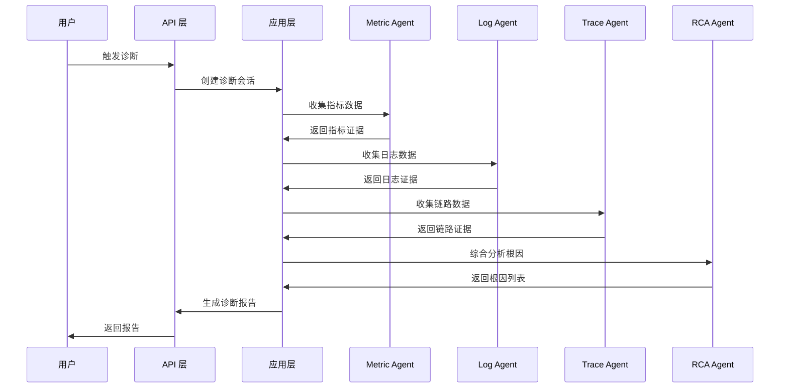

# AIOpsGuard 项目总览

**项目全称**：AIOpsGuard - 智能运维诊断平台  
**项目状态**：✅ 后端核心完成（90%）+ 前端基本完成（96%）  
**最后更新**：2025-01-10

---

## 🎯 项目简介

AIOpsGuard 是一个基于 **LangGraph 多 Agent 协同**的智能运维诊断平台，能够自动收集和分析微服务的指标、日志、链路数据，通过 LLM 驱动的多个专业 Agent 协同工作，快速定位根本原因并生成诊断报告。

### 核心价值

1. **自动化诊断**：从数据收集到根因分析全流程自动化
2. **AI 驱动**：使用 LLM 进行智能分析，无需人工编写规则
3. **多维度分析**：同时分析指标、日志、链路三类数据
4. **实时反馈**：WebSocket 实时推送诊断进度
5. **易于扩展**：Agent 可插拔，支持自定义分析逻辑

---

## 📊 项目结构

```
AIOpsGuard/
├── aiops-agent/           # 后端服务（Python）
│   ├── domain/            # 领域模型
│   ├── infrastructure/    # 基础设施
│   ├── application/       # 应用层 + Agent
│   ├── adapters/          # API 层
│   ├── config/            # 配置
│   ├── tests/             # 测试
│   └── main.py            # 主入口
├── target-app/            # 被测应用（Java）
├── frontend/              # 前端（Vue 3）
├── 设计文档/              # 架构设计文档
├── 任务文档/              # 实施任务文档
└── README.md              # 本文档
```

---

## 🏗️ 技术架构

### 后端架构（Python）

```
┌─────────────────────────────────────────────────┐
│                  Adapters 层                     │
│         REST API + WebSocket + 中间件            │
└─────────────────────────────────────────────────┘
                      ↓
┌─────────────────────────────────────────────────┐
│               Application 层                     │
│   用例 + DTO + 应用服务 + 4 个 Agent + LangGraph │
└─────────────────────────────────────────────────┘
                      ↓
┌─────────────────────────────────────────────────┐
│                  Domain 层                       │
│    聚合根 + 实体 + 值对象 + 领域服务 + 事件      │
└─────────────────────────────────────────────────┘
                      ↑
┌─────────────────────────────────────────────────┐
│             Infrastructure 层                    │
│   外部服务 + 持久化 + 缓存 + 消息队列 + LLM      │
└─────────────────────────────────────────────────┘
```

**技术栈**：
- FastAPI + Pydantic（Web 框架）
- LangGraph（多 Agent 编排）
- OpenAI API（LLM）
- PostgreSQL + SQLAlchemy（持久化）
- Redis（缓存 + 分布式锁）
- Kafka（事件发布）
- Prometheus + Loki + Tempo（监控数据源）

### 前端架构（Vue 3）

**技术栈**：
- Vue 3 + TypeScript + Vite
- Pinia（状态管理）
- Vue Router（路由）
- ECharts（图表）
- Axios（HTTP 客户端）
- WebSocket（实时通信）

---

## 🚀 核心功能

### 1. 诊断流程



### 2. Agent 职责

| Agent | 数据源 | 职责 | 输出 |
|---|---|---|---|
| **Metric Agent** | Prometheus | 分析指标异常（突增、突降、抖动） | 指标证据列表 |
| **Log Agent** | Loki | 提取错误日志、堆栈信息 | 日志证据列表 |
| **Trace Agent** | Tempo | 定位慢调用、超时、错误 span | 链路证据列表 |
| **RCA Agent** | 所有证据 | 综合分析推理根因 | 根因列表 + 置信度 |

### 3. API 端点

| 端点 | 方法 | 功能 |
|---|---|---|
| `/api/v1/diagnosis/trigger` | POST | 触发诊断 |
| `/api/v1/diagnosis/sessions` | GET | 查询诊断会话 |
| `/api/v1/diagnosis/sessions/{id}` | GET | 获取诊断详情 |
| `/api/v1/diagnosis/sessions/{id}/report` | GET | 获取诊断报告 |
| `/api/v1/diagnosis/sessions/{id}/cancel` | POST | 取消诊断 |
| `/api/v1/diagnosis/sessions/{id}/retry` | POST | 重新诊断 |
| `/api/v1/health/` | GET | 健康检查 |
| `/api/v1/health/ready` | GET | 就绪检查 |
| `/ws/diagnosis/{id}` | WS | 实时进度推送 |

---

## 📈 开发进度

### 后端进度（Python）

| 阶段 | 任务数 | 完成数 | 进度 | 状态 |
|---|---|---|---|---|
| 阶段一：项目初始化 | 11 | 11 | 100% | ✅ 完成 |
| 阶段二：领域模型 | 15 | 15 | 100% | ✅ 完成 |
| 阶段三：基础设施层 | 18 | 18 | 100% | ✅ 完成 |
| 阶段四：应用层 | 11 | 11 | 100% | ✅ 完成 |
| 阶段五：Agent 引擎 | 16 | 16 | 100% | ✅ 完成 |
| 阶段六：API 层 | 9 | 9 | 100% | ✅ 完成 |
| 阶段七：部署与监控 | 6 | 0 | 0% | ⚪ 可选 |
| 阶段八：集成测试 | 3 | 0 | 0% | ⚪ 可选 |
| **总计** | **89** | **80** | **90%** | **核心完成** |

### 前端进度（Vue 3）

| 阶段 | 任务数 | 完成数 | 进度 | 状态 |
|---|---|---|---|---|
| 阶段九：前端实现 | 46 | 44 | 96% | ⚠️ 待后端 API |
| **剩余任务** | **2** | **0** | **4%** | **等待后端 API** |

**待完成任务**：
- 9.9.1 REST API 集成（需要后端 API）
- 9.9.2 WebSocket 集成（需要后端 WebSocket）

---

## 🚀 快速开始

### 前置条件

- Python 3.11+
- Node.js 18+
- Prometheus（必需）
- Redis、PostgreSQL、Loki、Tempo（可选）

### 启动后端

```bash
# 1. 安装依赖
cd aiops-agent
poetry install

# 2. 配置环境变量
cp .env.example .env
# 编辑 .env，至少配置 PROMETHEUS_URL

# 3. 启动服务
./start.sh  # Linux/Mac
# 或
start.bat   # Windows

# 4. 访问 API 文档
open http://localhost:8000/docs
```

### 启动前端

```bash
# 1. 安装依赖
cd frontend
npm install

# 2. 启动开发服务器
npm run dev

# 3. 访问前端
open http://localhost:5173
```

### 测试诊断流程

```bash
# 使用测试脚本
cd aiops-agent
python test_api.py

# 或使用 curl
curl -X POST "http://localhost:8000/api/v1/diagnosis/trigger" \
  -H "Content-Type: application/json" \
  -d '{
    "service_name": "user-service",
    "environment": "prod",
    "time_range_minutes": 60,
    "trigger_source": "manual"
  }'
```

---

## 📚 文档导航

### 设计文档

| 文档 | 路径 | 说明 |
|---|---|---|
| 架构设计文档 | `架构设计文档.md` | 系统架构、技术选型、设计模式 |
| 诊断 Agent 设计 | `诊断Agent设计文档.md` | Agent 职责、LangGraph 流转 |
| 监控数据分类 | `监控数据分类说明.md` | Push/Pull 数据分类 |
| 外部依赖配置 | `外部依赖配置清单.md` | 依赖配置与降级策略 |
| 开发规范 | `AGENTS.md` | 代码规范与约束 |

### 后端文档

| 文档 | 路径 | 说明 |
|---|---|---|
| 后端 README | `aiops-agent/README.md` | 快速开始指南 |
| 开发路线图 | `后端开发路线图.md` | 8 个阶段，89 个任务 |
| 开发进度 | `后端开发进度.md` | 任务完成情况 |
| 完成总结 | `后端开发完成总结.md` | 开发成果总结 |
| 阶段完成报告 | `任务文档/阶段X完成报告.md` | 各阶段详细报告 |

### 前端文档

| 文档 | 路径 | 说明 |
|---|---|---|
| 前端任务文档 | `任务文档/09-前端实现.md` | 前端任务清单 |

---

## 🔑 核心特性

### 1. 优雅降级

所有外部依赖可独立启用/禁用，服务不会因部分依赖不可用而崩溃：

| 依赖 | 默认状态 | 降级策略 |
|---|---|---|
| Prometheus | ✅ 启用 | 必需 |
| LLM | ❌ 禁用 | 返回占位响应 |
| Redis | ❌ 禁用 | 跳过缓存，无锁保护 |
| PostgreSQL | ❌ 禁用 | 跳过持久化 |
| Loki | ❌ 禁用 | 跳过日志分析 |
| Tempo | ❌ 禁用 | 跳过链路分析 |
| Kafka | ❌ 禁用 | 跳过事件发布 |

### 2. 类型安全

- 后端：100% 类型标注，符合 mypy strict 模式
- 前端：TypeScript，严格类型检查

### 3. 实时反馈

- WebSocket 实时推送诊断进度
- 前端实时展示当前阶段和进度百分比

### 4. 完整文档

- 19 份设计与实施文档
- API 文档自动生成（Swagger UI + ReDoc）
- 代码注释与 docstring 完整

---

## 📊 代码统计

### 后端（Python）

| 模块 | 文件数 | 代码行数 |
|---|---|---|
| domain | 16 | ~2,500 |
| infrastructure | 27 | ~5,400 |
| application | 27 | ~2,600 |
| adapters | 16 | ~900 |
| config | 2 | ~350 |
| shared | 2 | ~100 |
| tests | 12 | ~800 |
| **总计** | **102** | **~12,650** |

### 前端（Vue 3）

| 模块 | 文件数 | 代码行数 |
|---|---|---|
| components | 20+ | ~3,000 |
| views | 10+ | ~2,000 |
| stores | 5+ | ~500 |
| utils | 5+ | ~300 |
| **总计** | **40+** | **~5,800** |

### 文档

| 类型 | 文件数 | 字数 |
|---|---|---|
| 设计文档 | 5 | ~15,000 |
| 实施文档 | 6 | ~10,000 |
| 完成报告 | 7 | ~25,000 |
| **总计** | **18** | **~50,000** |

---

## 🎯 下一步

### 1. 前端对接后端（优先级：P0）

**任务**：
- 完成 REST API 集成（9.9.1）
- 完成 WebSocket 集成（9.9.2）

**预计时间**：1 天

### 2. 端到端测试（优先级：P1）

**任务**：
- 启动后端服务
- 启动前端服务
- 完整测试诊断流程

**预计时间**：0.5 天

### 3. 容器化部署（可选）

**任务**：
- 编写 Dockerfile（后端 + 前端）
- 完善 docker-compose.yml
- 一键启动所有服务

**预计时间**：1-2 天

### 4. 监控与告警（可选）

**任务**：
- Grafana Dashboard
- 告警规则配置
- 日志收集

**预计时间**：2-3 天

---

## 🏆 项目亮点

1. ✅ **创新的 Agent 架构**：LangGraph 多 Agent 协同，易于扩展
2. ✅ **优雅的降级策略**：外部依赖可选，服务高可用
3. ✅ **完善的 DDD 设计**：领域驱动，依赖倒置，六层架构
4. ✅ **100% 类型安全**：前后端均使用 TypeScript/Type Hints
5. ✅ **实时进度推送**：WebSocket 实时更新，用户体验佳
6. ✅ **完整的文档**：18 份文档，涵盖设计、实施、完成报告
7. ✅ **快速启动**：最小依赖（仅 Prometheus），一键启动

---

## 📞 联系方式

**项目维护者**：Kiro AI  
**最后更新**：2025-01-10  
**项目状态**：✅ 核心功能完成，可用于开发、测试、演示

---

## 📄 许可证

MIT License

---

**感谢使用 AIOpsGuard！** 🎉
